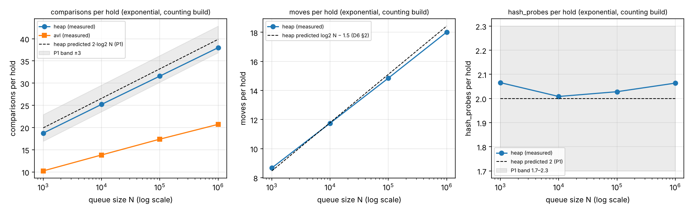
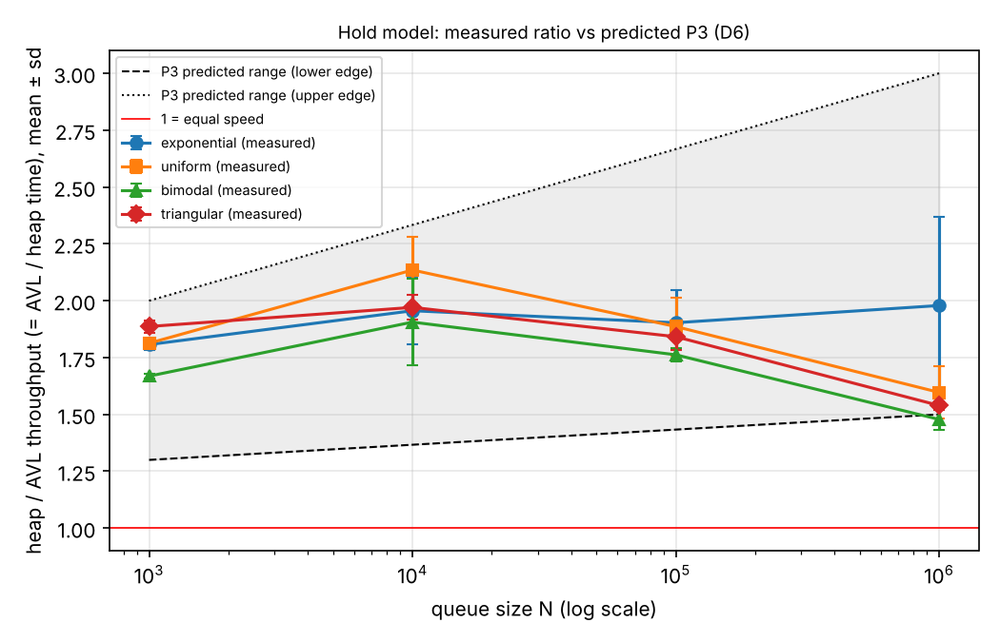
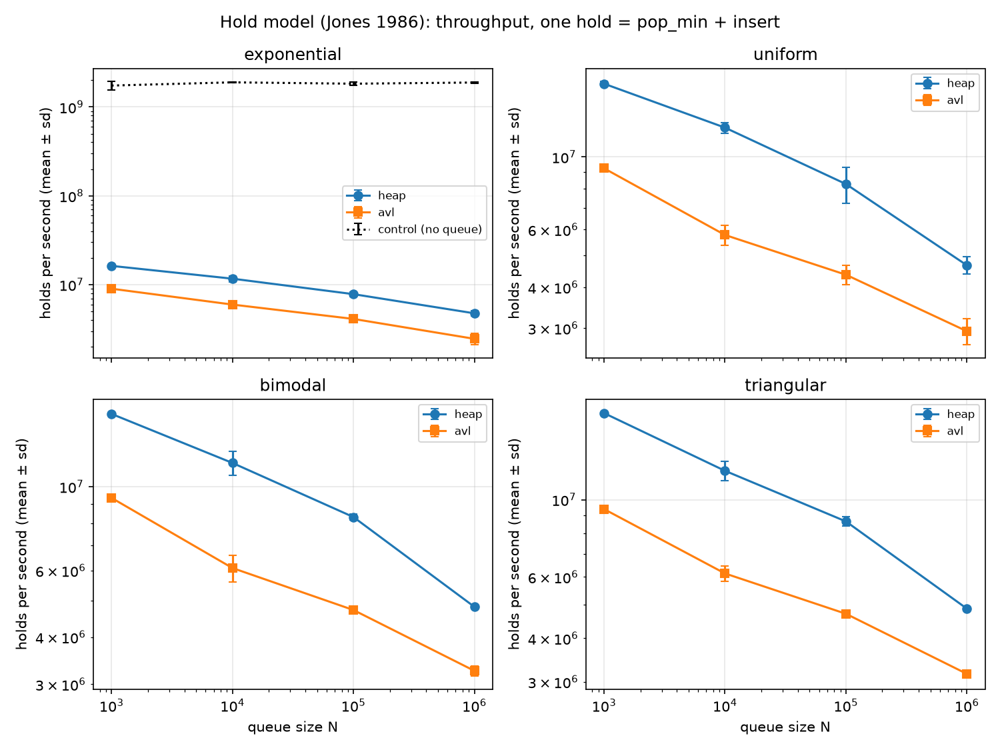
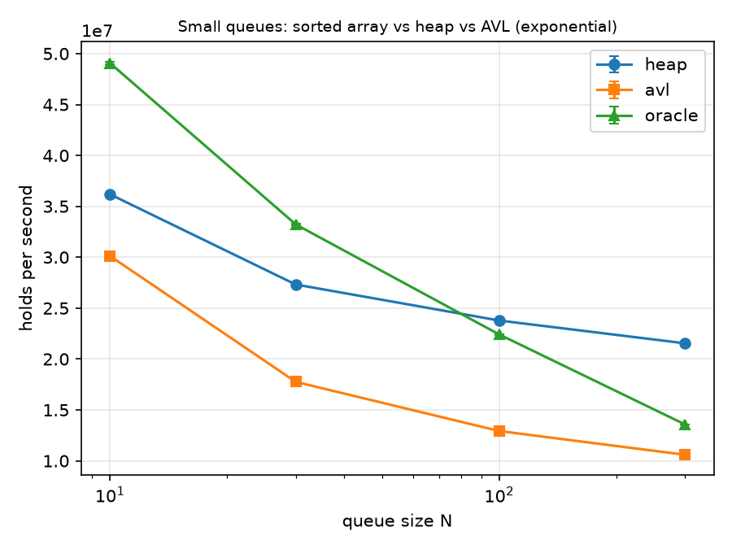
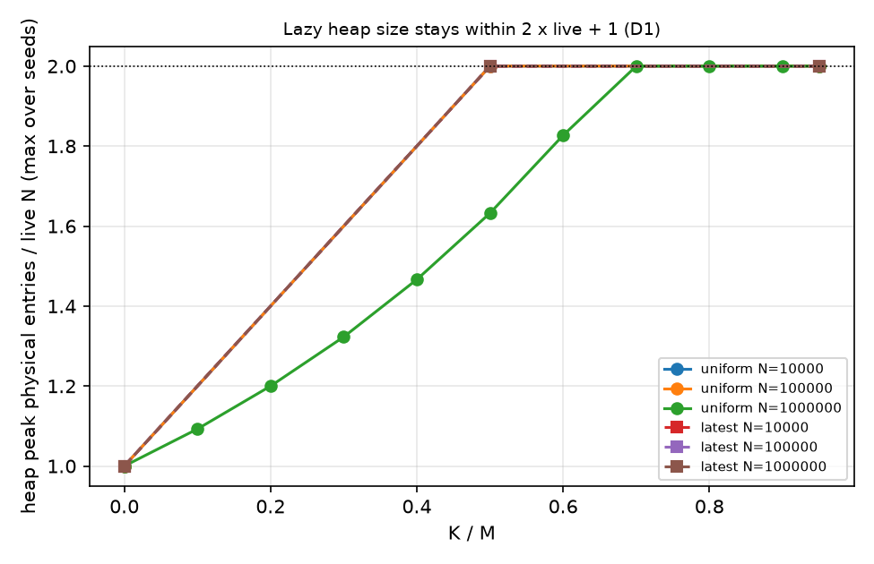

# REPORT — Project 9: Event scheduler, heap against balanced tree

Team O(n²) · CS 253 / MA 253 Data Structures and Algorithms Laboratory, IIT Indore · Autumn 2026

> **Where the numbers come from.** Sections marked **[MEASURE]** are written by
> `scripts/fill_report.py` only from files that `make bench` produced on the one machine named in §10.1
> (`results/summary.csv`, `results/raw/`, `results/profiler/`). Sections marked **[DETERMINISTIC]** are
> reproduced exactly by `make test` on any machine. No number is copied from anywhere else. AI use is
> declared in TOOLS.md.

**Contents.** 1 Team and contributions · 2 Problem · 3 Interface and invariants · 4 Structure A ·
5 Structure B · 6 The requirement beyond the lecture · 7 Correctness · 8 Adversarial inputs ·
9 Predicted cost model · 10 Experimental setup · 11 Results · 12 Limitations · 13 References ·
Appendix A Derivations

## 1. Team and contributions

| Name | Roll no. | GitHub | Role | Module folder | Derivation |
|---|---|---|---|---|---|
| Aditya Singh | 250003007 | @meowditya | Architect | `include/`, `app/`, `scripts/` (build, test, demo) | D3 |
| Gulam Abbas | 250041016 | @GulamAbbas07 | Structure A owner | `src/structA/` | D1 |
| Aryan Arya | 250001009 | @Coder1713 | Structure B owner | `src/structB/` | D2 |
| Hiransh Anand | 250041018 | @hiransh116 | Oracle owner | `oracle/` | D4 |
| Sanchit Goyal | 250041035 | @sanchit1707 | Adversary | `adversary/` | D5 |
| Ram Upadhyay | 250001058 | @Ram-ui31 | Analyst | `bench/`, `results/` | D6 |

The first draft of every module was generated with Claude in one session after INTERFACE.md was fixed
(declared in TOOLS.md, with what each member changed and verified). Each owner reviewed their module,
committed it from their own account through a pull request reviewed by another member, and answers for
it in the viva.

- **Aditya Singh (Architect).** The shared interface `include/event_queue.h`, `include/rng.h`,
  `include/opstream.h`, `include/canonical.h`, `INTERFACE.md`, the `Makefile` and the interface contract
  test ([#1](https://github.com/meowditya/cs253-on2-p09/pull/1), [`5659ccf`](https://github.com/meowditya/cs253-on2-p09/commit/5659ccf)); the shared test helper and op-stream test ([#2](https://github.com/meowditya/cs253-on2-p09/pull/2)); the retransmission-timer
  simulator `app/`, the queue factory, `tests/test_sim.cpp`, `scripts/run_tests.sh`,
  `scripts/check_identical.sh`, `scripts/demo.sh` and D3 ([#9](https://github.com/meowditya/cs253-on2-p09/pull/9), [#10](https://github.com/meowditya/cs253-on2-p09/pull/10), [#11](https://github.com/meowditya/cs253-on2-p09/pull/11); D3.pdf fixed in [#12](https://github.com/meowditya/cs253-on2-p09/pull/12));
  `scripts/fill_report.py` (committed in [#13](https://github.com/meowditya/cs253-on2-p09/pull/13)); the full `make bench` run on his Mac and its results
  ([#16](https://github.com/meowditya/cs253-on2-p09/pull/16)); `scripts/run_all.sh`, this report's structure and the README.
- **Gulam Abbas (Structure A).** `src/structA/seq_table.{h,cpp}` (the hash table written from scratch)
  and `src/structA/lazy_heap.{h,cpp}`, `tests/test_structA.cpp` and D1 ([#4](https://github.com/meowditya/cs253-on2-p09/pull/4), [`318151a`](https://github.com/meowditya/cs253-on2-p09/commit/318151a)); owner's
  review ([#17](https://github.com/meowditya/cs253-on2-p09/pull/17)).
- **Aryan Arya (Structure B).** `src/structB/avl_queue.{h,cpp}` (pool-based AVL tree),
  `tests/test_structB.cpp` and D2 ([#6](https://github.com/meowditya/cs253-on2-p09/pull/6), [`d438582`](https://github.com/meowditya/cs253-on2-p09/commit/d438582)); owner's review ([#18](https://github.com/meowditya/cs253-on2-p09/pull/18)).
- **Hiransh Anand (Oracle).** `oracle/` — the sorted-array oracle, the invariant checkers, `replay`, the
  differential test with its shrinker — and `tests/test_oracle.cpp`, `tests/test_checkers_mutations.cpp`,
  `tests/test_fullscale.cpp` and D4 ([#7](https://github.com/meowditya/cs253-on2-p09/pull/7), [`9d55897`](https://github.com/meowditya/cs253-on2-p09/commit/9d55897)); owner's review ([#21](https://github.com/meowditya/cs253-on2-p09/pull/21)).
- **Sanchit Goyal (Adversary).** `adversary/gen.cpp`, `adversary/distributions.h` (Jones's Table I), the
  16 suites with expected outputs, `scripts/run_suites.sh`, `tests/cli_test.sh`, `tests/run_timeout.py`
  and D5 ([#8](https://github.com/meowditya/cs253-on2-p09/pull/8), [`f0885d4`](https://github.com/meowditya/cs253-on2-p09/commit/f0885d4)); owner's review ([#19](https://github.com/meowditya/cs253-on2-p09/pull/19)).
- **Ram Upadhyay (Analyst).** The cost model `docs/MODEL_D6.md` = D6, committed before any measurement
  ([#3](https://github.com/meowditya/cs253-on2-p09/pull/3), [`9b2bab6`](https://github.com/meowditya/cs253-on2-p09/commit/9b2bab65be34c50b45bac9bac46e5e6b0f18c648)); the benchmark harness `bench/`,
  `results/plot.py`, `scripts/run_bench.sh`, `scripts/profile.sh`, `tests/plot_test.py`,
  `tests/profile_test.sh` ([#13](https://github.com/meowditya/cs253-on2-p09/pull/13), [`317f096`](https://github.com/meowditya/cs253-on2-p09/commit/317f096)); owner's review ([#20](https://github.com/meowditya/cs253-on2-p09/pull/20)).

## 2. Problem

A discrete-event network simulator keeps a *future event set*: every pending event has a timestamp, and
the simulator repeatedly takes the earliest one and handles it. In a transport protocol most of these
events are timers that never fire. When a packet is sent, a retransmission timeout is scheduled; when its
acknowledgement (ACK) arrives first, the timeout must be **cancelled**. The simulator also needs "the next
event after time t" for monitoring. So the event set must support insert, cancel, delete-min and
successor, under a workload where cancellations outnumber firings.

We implement that event set twice — a binary heap with lazy cancellation (Structure A) and an AVL tree
(Structure B) — behind one interface, prove both correct against an oracle, attack both with adversarial
inputs, drive both with the simulator below, and measure them with Jones's hold model (§6) and a
cancellation sweep.

**Scale.** The simulator dispatches exactly 10⁶ events (about 2.96·10⁶ inserted, 1.9·10⁶ cancelled);
the full-scale test and the benchmarks hold 10⁶ events resident at once; the differential test runs
10⁶ operations per seed.

### 2.1 The application **[DETERMINISTIC]**

Stop-and-wait flows with a retransmission timer and an ACK-inactivity watchdog; exactly 10⁶ dispatched
events; integer arithmetic only. Default run (`sim`, seed 1), identical on heap and AVL:

```
inserted=2962238 processed=1000000 cancelled=1907484 pending=54754
rto_cancelled=953742 idle_cancelled=953742
transmissions=1019981 retransmissions=46239 delivered=953742 idle_fired=0 monitors=19
ties=222069 peak_live=59028 end_time_us=1929077
checksum=0xcbd12e722cac3922
monitor_successors=0xebce99f1c00b6707
```

64.4 % of scheduled events are cancelled (model estimate 2q/(1+2q) = 65.5 % at q = 0.95, minus
start-up/end effects); 222 069 consecutive equal timestamps exercise the tie rule; conservation
`inserted = processed + cancelled + pending` is checked after every event.

Each flow is stop-and-wait: one packet in flight; its ACK arrives after a random round-trip time unless
the packet is lost (5 % by default), and its retransmission timeout (RTO = 200 ms, longer than any
round-trip time) fires only if no ACK came. Each ACK cancels that flow's timeout and its inactivity
watchdog, re-arms the watchdog and sends the next packet — one pop, two cancels and up to three inserts.

## 3. Interface and invariants

Every structure implements
`include/event_queue.h` (contract and invariants in INTERFACE.md):

| Operation | Meaning |
|---|---|
| `insert(t, type, data) → handle` | key = (t, seq); seq assigned by the base class, so keys are unique |
| `cancel(handle) → bool` | true exactly once while the event is pending |
| `pop_min`, `peek_min` | the pending event with the smallest key |
| `successor(t)` | the pending event with the smallest key among those with time > t (strict) |

Design decisions: integer microsecond time (real ties, no floating-point drift); key = (time, seq) so
ties leave FIFO and the order is total (D3); handle = key (the AVL tree cancels by key, the heap checks
seq *and* time); one shared, exact cancel semantics so the differential test can compare everything;
our own integer mapping on `std::mt19937_64` instead of `std::*_distribution` (portable output).

**Structural invariants checked by the checkers** (`oracle/checkers.cpp`, from INTERFACE.md §5). They
are recomputed from the raw arrays without trusting any stored field — in the unit tests, after every
operation of the hand-written suites, at intervals in the generated suites, and every 1000 operations in the differential test (`difftest --check-every`).

| Structure | Invariant |
|---|---|
| A (lazy heap) | heap order: `!(a[i].key < a[(i−1)/2].key)` for every i ≥ 1 |
| A | every seq in the array is unique and `< issued()` |
| A | the table mirrors the array exactly: one record (seq, time, cancelled) per entry with the same time, no orphan records (checked by enumerating the table) |
| A | L = records not flagged = `size()`, C = records flagged, L + C = m |
| A | purge invariant: C ≤ L after every public operation, hence m ≤ 2L (D1) |
| A | table health: capacity a power of two ≥ 16, occupied + tombstones ≤ capacity/2, no reserved key in use, every record reachable along its probe path |
| B (AVL) | every child index in range; no cycles, no node reached twice |
| B | strict BST order on (time, seq) |
| B | stored heights correct: h(NIL) = −1, h(x) = 1 + max(h(left), h(right)) |
| B | balance: \|h(left) − h(right)\| ≤ 1 at every node, from recomputed heights (D4) |
| B | reachable seqs unique and `< issued()`; reachable count = `size()`; every pool slot reachable or on the free list, never both |
| Oracle | strictly descending array, minimum last; seqs unique and `< issued()`; k = `size()` |

## 4. Structure A — lazy binary heap (Gulam Abbas)

The heap is an array of entries (time, seq, type, data) ordered by the key (time, seq); the children of
index i are 2i+1 and 2i+2. Sift-up and sift-down use the hole method: the moving entry is held aside,
entries slide into the hole, and it is written once at the end, so a sift of depth d costs d+1 moves
instead of 3d.

```
 heap array (ordered by key)            SeqTable (open addressing, keyed by seq)
 [0] (5,#3)                              slot = (seq * 0x9E3779B97F4A7C15) >> (64 - log2 capacity)
 [1] (7,#1)   [2] (9,#4)                 record: seq -> (time, cancelled flag)
 [3] (8,#2)x  ...                        x = cancelled: still in the array, flagged in the table
```

**Cancellation is lazy.** A binary heap cannot find an entry by handle, so every entry in the array has
a record in `SeqTable`: open addressing with linear probing, Fibonacci hashing of the sequence number,
tombstones on erase, and a rebuild when occupied + tombstones exceed half the capacity. `cancel(h)`
looks the handle up, checks both seq and time, and sets a flag — O(1) expected, no sifting. The entry
stays in the array until it reaches the root, where `pop_min`/`peek_min` discard it, or until a purge.

**Purge.** With L live and C cancelled entries, the heap purges whenever C > L, after every successful
cancel *and* after every pop (a pop lowers L, so it can also break C ≤ L). A purge keeps the live
entries, erases the cancelled records and rebuilds the heap with Floyd's method. Hence the array never
holds more than 2L entries after an operation, and the cost is O(log n) amortised (D1).

**Successor(t)** is a depth-first search that prunes every subtree whose root time is already no better
than the best candidate; it is O(m) in the worst case, which is the heap's honest weakness for this
operation and the AVL tree's strength.

**Decision we defend.** The table records every heap entry, not only cancelled ones, so `cancel` has
exactly the same meaning on both structures (false for an unknown, popped or already cancelled handle)
and the differential test can compare every return value. To keep that cheap, `pop_min` reuses the
slot it found when checking the root to erase the record, so a hold without cancellations costs two
table operations (one lookup-and-erase, one insert), not three.

| Operation | Cost (m = physical entries, n = live, m ≤ 2n) |
|---|---|
| `insert` | O(log m) sift-up + O(1) expected table insert (amortised over table rebuilds) |
| `cancel` | O(1) expected lookup and flag, plus an O(1) amortised share of purges (D1) |
| `pop_min` | O(log m) per root removed; each stale root is paid for by its own cancel, so O(log n) amortised |
| `peek_min` | discards stale roots (amortised as above), then O(1) |
| `successor(t)` | O(m) worst case (pruned depth-first search) |
| purge | O(m): one scan with a table lookup per entry, then Floyd's build-heap on the live entries |

**Alternatives we rejected.** (1) *Eager deletion through a position index* (the table stores each
entry's array index, and `cancel` removes it with a sift): every sift move would then also update the
table, which slows every hold to make cancel O(log n); lazy flags keep holds at two table operations.
(2) *Purging only after cancels*: the drain attack (§8) shows C > L can then persist, because pops also
lower L. (3) *A library hash map* (`std::unordered_map`) for the handle table: not allowed for a
structure under study, and it allocates a node per record.

## 5. Structure B — AVL tree (Aryan Arya)

Nodes live in one contiguous pool (a growable array) and refer to each other by 32-bit indices, not
pointers; freed nodes go on a free list and are reused. Index 0 is NIL, a sentinel whose height is −1,
so `height(child)` needs no null test and a leaf has height 0.

`insert` and `cancel` (delete by key) are recursive: they walk down by comparing (time, seq), and on
the way back up every node recomputes its height and is rebalanced if its children's heights differ by
2. `pop_min` deletes along the left spine. `successor(t)` is one root-to-leaf walk that remembers the
last node with time > t: O(log n).

```
   left-heavy at z, left child y not right-heavy: one right rotation

          z                    y
         / \                  / \
        y   D      ==>       x   z
       / \                      / \
      x   C                    C   D
```

If y leans the other way (the "zig-zag" case) y is first rotated left, then z right: a double rotation.
The rule uses strict comparison of the grandchildren's heights, so the equal-height case that arises
only in deletion takes the single rotation. An insertion needs at most one rebalance (D5); a deletion
can need one at every level (the Fibonacci-tree attack in §8 makes it do so). The height is below
1.45·log₂(n+2) (D2).

**Decision we defend.** Because the pool can grow and move during an insertion, the code never keeps a
reference or pointer to a node across a call that may allocate: it holds indices and re-reads the node
afterwards. This is the bug class that indices-in-a-pool invites, and the sanitizer runs cover it.

| Operation | Cost (n = live nodes, height < 1.45·log₂(n+2), D2) |
|---|---|
| `insert` | O(log n), at most one rebalance (D5) |
| `cancel` (delete by key) | O(log n), up to one rebalance per level on the way up |
| `pop_min` | O(log n) down the left spine, rebalancing on the way up |
| `peek_min` | O(log n) walk down the left spine |
| `successor(t)` | O(log n): one root-to-leaf walk |

**Alternatives we rejected.** (1) *Nodes allocated one by one with pointers*: one allocation per insert
and nodes scattered in memory; the pool with 32-bit indices allocates rarely, reuses freed slots and
makes a node 40 bytes. (2) *A red-black tree*: it rotates less on deletion, but its height bound is
2·log₂(n+1) instead of 1.45·log₂(n+2), and `pop_min`, `successor` and every search walk the height.
(3) *Parent pointers for an iterative implementation*: one more field to keep consistent through every
rotation; the recursion depth is the height (under 30 at n = 10⁶), so recursion is safe.

## 6. The requirement beyond the lecture: Jones's hold model

The measurement method comes from the reading list: D. W. Jones, *An empirical comparison of
priority-queue and event-set implementations*, Communications of the ACM 29(4), 1986 [1].

**What the paper does.** Jones compares event-set structures with the *hold model*: the queue is first
brought to size N, and then one *hold* — remove the minimum, insert a new event at the removed time plus a
random increment — is repeated, so the size stays N while the queue's contents keep moving forward in
time. The increments are drawn from the distributions of his Table I (exponential, uniform, biased,
bimodal, triangular). The queue is built by a random walk of enqueues and dequeues so that its shape is
representative, not only its times.

**How we implemented it** (`bench/hold.cpp`, `adversary/distributions.h`, `bench/bench_common.h`):

1. initialisation by Jones's random walk, P(enqueue) = 0.55 (forced when empty), each new time = time of
   the most recently dequeued event + increment, until the size is N — untimed;
2. max(10⁶, 5N) warm-up holds, untimed;
3. max(10⁶, N) timed holds, with all increments generated before the clock starts;
4. the four distributions of Table I in the matrix (biased is implemented and available as a fifth),
   N = 10³ … 10⁶, five seeds, heap and AVL alternated AB/BA on the same seed;
5. an overhead control: the same loop with no queue, replaying the popped times.

**Where we differ from the paper.**

- *Bimodal mean.* Jones states that every distribution has mean 1, but the printed bimodal formula has
  mean 0.95238/2 + 0.1·9.5238 = 1.42857. We keep the printed formula and divide every sample by its
  ideal mean, so all distributions have mean 1 (`adversary/distributions.h`).
- *Integer time.* Our queues use integer microseconds (§3), so increments are scaled to mean 1000 µs and
  rounded; rounding makes some increments zero (real ties). §11.5 repeats two points at mean 10⁶ µs, where
  almost no increment rounds to zero, and the faster structure does not change.
- *Paired comparison.* We compare heap and AVL by throughput ratios on the same seed and workload, and
  validate every CSV before plotting (`results/plot.py`), which the paper does not need to do.
- *Scope.* Jones measured many structures on 1980s hardware; we measure two (plus the sorted array for
  small N) on one 2026 machine, where caches matter far more than in 1986, so his absolute rankings are not
  expected to carry over.
- *Cancellation.* The hold model has no cancellations; our application cancels most timers, so we add the
  cancellation sweep (§10.2, §11.4), which is ours, not Jones's.

## 7. Correctness (Hiransh Anand) **[DETERMINISTIC]**

| Evidence | Result (`make test`) |
|---|---|
| Hand-computed edge-case suites (5 files), checker after every operation | identical on heap, AVL, oracle |
| Generated attack suites (11 files) vs oracle output | identical on heap and AVL |
| Differential test, seeds 1, 2, 3, 10⁶ operations each, live size ≤ 10⁴ | no disagreement; checkers passed |
| Mutation tests: LIFO ties, cancel ignoring time, non-strict successor, no post-pop purge, stale AVL height, duplicate heap entry + orphan record, bad AVL edges (out of range, cycle, shared child, leaked slot), table record moved past an EMPTY slot (unreachable by probing, so `cancel` would fail) | all 8 caught |
| Shrinker on a planted bug | literal `.ops` reproducer; the test re-checks that removing any single operation makes the bug disappear (1-minimal) |
| Command-line hardening (`tests/cli_test.sh`) | out-of-range or malformed arguments exit 2 at once (no hang, no `inf`/`nan` rows); a CSV or stdout write failure (e.g. a full disk) exits 4 instead of reporting success; `plot.py` rejects empty CSVs |
| CSV validation (`tests/plot_test.py`, synthetic fixture) | 15 defects each rejected before any output is written: mismatched warm-up / holds / steps, checksum disagreement, duplicate row, missing queue mate, incomplete matrix, row outside the matrix, inconsistent cancels, out-of-range values, `nan`, wrong build, empty file; exact ties classified as ties |
| Profiler logic (`tests/profile_test.sh`, fake `perf`) | USABLE / UNAVAILABLE / FAILED reported correctly (zero or implausible counts, a failed run, a failed self-check all give FAILED and exit 1); the benchmark exits 3 if perf does not acknowledge enable/disable |
| Full scale: 10⁶ resident events in each structure, drained in order; heap vs AVL on 10⁶ mixed operations at 10⁶ live | passed |
| Sanitizers (ASan + UBSan, leak detection on) over the whole suite | clean |
| Toolchains: g++ 13 / libstdc++, clang 18 / libstdc++, clang 18 / libc++ | all tests pass; identical simulator output |

Unit tests only check the cases someone thought of. The differential test instead runs the same
generated history on the heap, the AVL tree and the oracle in lockstep and compares every return value
and every returned event, so any disagreement on any operation among a million is caught, and the
shrinker cuts the history down to a few lines. The oracle is a sorted array, simple enough to be
checked by reading. Agreement of outputs is still not enough — a structure can answer correctly while
its internals are already corrupt — so the checkers recompute each structure's invariants from the
raw arrays without trusting any stored field: heap order, table/array agreement and probe-path
reachability for A; ordering, recomputed heights, balance and reachability for B (D4 proves the AVL
checker accepts exactly the valid trees). The mutation tests show that each of these checks can fail.

**The differential test.** `difftest --seed S --ops 1000000` for seeds 1, 2 and 3 (live size at most 10⁴;
run by `make test` through `scripts/run_tests.sh`): one generated history of inserts, cancels, pops,
peeks and successor queries runs on the heap, the AVL tree and the oracle in lockstep; every return
value and returned event must agree, and all three checkers run every 1000 operations. Each passing
seed prints `difftest seed=S ops=1000000 max_live=10000: PASS (oracle = heap = avl on every result;
checkers passed)`, and `make test` ends with `ALL TESTS PASSED`.

### 7.1 Bug log

Real defects found in the project's code. Most were found by an external code review of the complete
draft and fixed before the code entered this repository, so the commit named is the one where the
fixed code was first committed.

| Date | Module | Symptom | How found | Fixed in |
|---|---|---|---|---|
| 9 Nov | all (counting) | operation counters were updated in timing builds too, adding work to the timed loop | external code review | [#1](https://github.com/meowditya/cs253-on2-p09/pull/1) (`include/event_queue.h`, `EQ_COUNT`) |
| 9 Nov | oracle | the heap checker accepted a table record moved past an EMPTY slot, unreachable by probing (so `cancel` would fail) | external review; mutant M8 now proves the check | [#7](https://github.com/meowditya/cs253-on2-p09/pull/7) (`oracle/checkers.cpp`) |
| 9 Nov | adversary, oracle, bench | `gen`, `replay`, `difftest`, `bench_*` accepted out-of-range or malformed arguments (hangs, `inf`/`nan` rows) | external review; now `tests/cli_test.sh` | [#7](https://github.com/meowditya/cs253-on2-p09/pull/7), [#8](https://github.com/meowditya/cs253-on2-p09/pull/8), [#13](https://github.com/meowditya/cs253-on2-p09/pull/13) |
| 9 Nov | bench | sweep arithmetic K = round(c·M) could overflow for large M | external review | [#13](https://github.com/meowditya/cs253-on2-p09/pull/13) (`bench/cancel_sweep.cpp`) |
| 9 Nov | bench, results | `plot.py` drew figures from incomplete or inconsistent CSVs (missing mates, duplicates, off-matrix rows) | external follow-up review; now `tests/plot_test.py` (15 defects rejected) | [#13](https://github.com/meowditya/cs253-on2-p09/pull/13) |
| 9 Nov | bench | the profiler counted set-up as well as the timed loop; zero counts were accepted | external follow-up review; now `tests/profile_test.sh` | [#13](https://github.com/meowditya/cs253-on2-p09/pull/13) (`scripts/profile.sh`) |
| 9 Nov | all programs | a failed CSV or stdout write (full disk) still exited 0 | external follow-up review | [#7](https://github.com/meowditya/cs253-on2-p09/pull/7), [#8](https://github.com/meowditya/cs253-on2-p09/pull/8), [#11](https://github.com/meowditya/cs253-on2-p09/pull/11), [#13](https://github.com/meowditya/cs253-on2-p09/pull/13) (exit code 4) |
| 9 Nov | oracle | the shrinker did not verify that its result was 1-minimal | external review | [#7](https://github.com/meowditya/cs253-on2-p09/pull/7) |
| 9 Nov | tests | the full-scale test did not keep exactly 10⁶ events live | external review | [#7](https://github.com/meowditya/cs253-on2-p09/pull/7) (`tests/test_fullscale.cpp`) |
| 19 Nov | scripts | `scripts/check_identical.sh` committed without its executable bit, so the test run could not execute it | running the tests from a clone | [#9](https://github.com/meowditya/cs253-on2-p09/pull/9) |
| 19 Nov | app | PR #9 was merged without the simulator sources | checking the merged tree | [#10](https://github.com/meowditya/cs253-on2-p09/pull/10), [#11](https://github.com/meowditya/cs253-on2-p09/pull/11) |
| 19 Nov | docs | `D3.pdf` held Markdown text instead of a PDF | checking the files on GitHub | [#12](https://github.com/meowditya/cs253-on2-p09/pull/12), [`d030e74`](https://github.com/meowditya/cs253-on2-p09/commit/d030e74) |
| 19 Nov | README | the commands table lost its separator row and rendered as text | reading the README on GitHub | [`4dbbb8e`](https://github.com/meowditya/cs253-on2-p09/commit/4dbbb8e) ([#16](https://github.com/meowditya/cs253-on2-p09/pull/16)) |

The *design* safeguards in §4 and §8 (purge after pops, strict successor, FIFO ties) are each guarded by
a mutation test that fails if the safeguard is removed; those are deliberate mutants, not bugs we had.

## 8. Adversarial inputs (Sanchit Goyal) **[DETERMINISTIC]**

| Attack | Target | What it did (`make test`) |
|---|---|---|
| ascending 1..N | AVL rotations | 990 rebalances for N = 1000; 999 980 for N = 10⁶ (rotation-free exactly at powers of two) |
| zigzag 1, N, 2, N−1, … | AVL double rotations | 617 double + 371 single rebalances for N = 1000 |
| Fibonacci tree + delete-min | deletion cascades | built with 0 rotations; then ONE delete-min performs ⌊h/2⌋ rotations (h = 10, 11, 20, 21, 27 → 5, 5, 10, 10, 13; h = 27 has 832 039 nodes) |
| bloat (L = 100, 3000 steps) | lazy-heap growth | 3 100 physical entries without purging vs 200 with purging |
| drain (N = 1000) | post-pop purge check | 500 entries for 1 live event without it vs 1 with it |
| storm, regrow, latesucc, random | ties, capacity reuse, O(m) heap successor | identical results on all three queues |

**Ascending and zigzag (AVL).** Inserting increasing keys always extends the rightmost path, so the
tree becomes right-heavy again and again; by D5 every insertion that does not raise the height of the
whole tree must rotate, so all but about 1.45·log₂ n insertions rotate. Zigzag (1, N, 2, N−1, …) places
each new key on the inside of a subtree, which is the double-rotation case.

**Fibonacci tree + delete-min (AVL).** A Fibonacci tree is the sparsest AVL tree: every internal node
already leans one way (D2's extremal case). Built with every node leaning right, removing the minimum
shortens the short side at the bottom, the rotation there shortens that subtree, and the imbalance
moves up: ⌊h/2⌋ rotations from one deletion, the O(log n) worst case that insertion never has.

**Bloat and drain (lazy heap).** Bloat cancels events with late timestamps and replaces them, so
cancelled entries never reach the root and, without purging, the array grows without bound while the
live size stays L; with the purge rule it stays within 2L (D1). Drain cancels half the events and then
pops the rest: only pops lower L, so a rule that purged after cancels alone would leave C > L — which
is why the heap also checks after every pop.

**Storm, regrow, latesucc, random.** Storm inserts many events at one timestamp (FIFO order among ties
must hold, D3). Regrow fills, empties and refills (capacity and free-list reuse). Latesucc asks for
successors near the largest time, where the heap's pruned search degenerates to O(m). Random mixes
everything from a seed. All give identical results on the three queues.

## 9. Predicted cost model (Ram Upadhyay)

The model is `docs/MODEL_D6.md` (= D6). It was committed on 17 Nov 2026, 19:43 IST, in
[`9b2bab6`](https://github.com/meowditya/cs253-on2-p09/commit/9b2bab65be34c50b45bac9bac46e5e6b0f18c648) ([#3](https://github.com/meowditya/cs253-on2-p09/pull/3)); the measurements it predicts were committed on
19 Nov 2026, 22:23 IST, in [`7ae0fdc`](https://github.com/meowditya/cs253-on2-p09/commit/7ae0fdc677bbb4f55379b8536f7e8ad30121f673) ([#16](https://github.com/meowditya/cs253-on2-p09/pull/16)). Its §0 states honestly what
was seen before it was written: Python pilot counts and Claude's smoke runs on a cloud VM (no number
from them is in this report). The predictions, as written:

| | Prediction |
|---|---|
| P1 | counting build: heap comparisons per hold ≈ 2·log₂N ± 3 and hash probes ≈ 2 ± 0.3; AVL rebalances per hold 0.9–1.2, for every distribution |
| P2 | the heap is faster than AVL at every N ≥ 10³ and every distribution |
| P3 | the AVL/heap time ratio grows with N, from about 1.3–2× at N = 10³ to about 1.5–3× at N = 10⁶ |
| P4 | heap time almost independent of the distribution; AVL times differ by < 20 % across distributions |
| P5 | the sorted array is fastest for N ≤ about 30 and loses to both from N ≈ 100–300 |
| P6 | as the cancellation rate rises the heap gets cheaper per step, AVL stays flat or gets dearer; the heap's advantage grows, no crossover |
| P7 | heap peak physical/live ≤ 2 at every cancellation rate (D1), approaching 2 at high rates |

The reasoning behind them is per operation: the heap's pop is a sift-down of about log₂N − 1.5 levels in
one contiguous 24-byte-per-entry array plus two table operations, while every AVL operation follows 32-bit
indices through 40-byte nodes that stop being neighbours in memory once the tree has churned; a heap
cancellation is a flag, an AVL cancellation is a full deletion. §11.1 tests each prediction mechanically.

## 10. Experimental setup (Ram Upadhyay)

<!-- MEASURED-A:BEGIN (generated by scripts/fill_report.py — do not edit by hand) -->
### 10.1 Machine **[MEASURE]**

```
date: Thu Nov 19 19:02:58 IST 2026
uname: Darwin Adityas-Mac-2.local 27.2.0 Darwin Kernel Version 27.2.0: Wed Oct 14 23:47:07 PDT 2026; root:xnu-13432.41.4~25/RELEASE_ARM64_T8132 arm64
Apple M4
hw.ncpu: 10
hw.l1dcachesize: 65536
hw.l2cachesize: 4194304
hw.memsize: 17179869184
compiler: Apple clang version 21.0.0 (clang-2100.4.1.1)
flags: -std=c++17 -O2 -DNDEBUG (release); counting build adds -DEQ_COUNTING=1
mode: --full
power: Now drawing from 'AC Power'
load average at start: 3.19 2.50 2.40
run conditions: one run, benchmarks strictly one after another; close other programs and stay plugged in
```

All timings below come from this one machine and this one run of `make bench`.
<!-- MEASURED-A:END -->

### 10.2 Method
Hold model as in Jones (1986): Jones's random-walk initialisation (P(enqueue) = 0.55), warm-up
max(10⁶, 5N) holds, then max(10⁶, N) timed holds with pre-generated increments; one hold = pop_min +
insert. Distributions: Jones Table I as printed, divided by their ideal means (the printed bimodal has
mean 1.42857, not 1 as Jones's footnote says), scaled to mean 1000 µs. Cancellation sweep: one step =
one successful removal + one insertion, exactly K = round(c·M) cancellations, victim uniform or
largest-key, stream generated before timing and replayed identically on A and B. Five seeds per point,
A and B on the same seed, order alternated (AB/BA).

The metric is **throughput** (the handout's): holds per second and steps per second, from the
`holds_per_sec` / `steps_per_sec` columns (CSV version 3), shown as mean ± sample s.d. over runs. A and B
are compared by **paired** throughput ratios heap/AVL on the same workload — same distribution, N,
warm-up, timed length, seed, repeat and mean (`results/paired_ratios.csv` lists every one). Throughput
is recomputed from the exact integers (operations × 10⁹ / elapsed_ns). `results/plot.py` writes nothing
unless every CSV is valid: right version, columns and build; values in range and mutually consistent;
no duplicate run; exactly the prescribed matrix (five seeds, prescribed warm-up and lengths, nothing
missing or extra); the same popped-key checksum for every queue on the same workload.

Operation counts come only from the counting build (`BUILD=count`, never timed); in timing builds all
`counters()` fields stay 0. A few structure statistics stay on in timing builds (heap purges, purged
and stale entries, peak size, table rebuilds; AVL rebalances): each is one integer increment on an
event that already does far more work (a purge, a rotation, a rebuild, a discarded root, an insert's
size check), so their cost is expected to be negligible; it was not measured separately.

| Experiment | Sizes | Repetitions and seeds | Raw file |
|---|---|---|---|
| hold model, 4 distributions | N = 10³, 10⁴, 10⁵, 10⁶ | 5 seeds (1–5) per point, heap and AVL on each | `results/raw/hold.csv` |
| small queues (sorted array, heap, AVL) | N = 10, 30, 100, 300 | 5 seeds | `results/raw/hold.csv` |
| quantisation check (mean 10⁶ µs) | N = 10⁵ | 5 seeds | `results/raw/hold.csv` |
| cancellation sweep, uniform | N = 10⁶, K/M = 0, 0.1, …, 0.9, 0.95 | 5 seeds | `results/raw/sweep.csv` |
| cancellation sweep, both policies | N = 10⁴, 10⁵, 10⁶, K/M = 0, 0.5, 0.95 | 5 seeds | `results/raw/sweep.csv` |
| operation counts (counting build, untimed) | as the hold model and the sweep | 1 seed per point | `results/raw/hold_count.csv`, `sweep_count.csv` |

Every row of the raw CSVs records its seed. `scripts/run_all.sh` reruns everything; `scripts/run_all.sh
--figures` redraws every figure from the committed raw files.

## 11. Results (Ram Upadhyay)

<!-- MEASURED-B:BEGIN (generated by scripts/fill_report.py — do not edit by hand) -->
### 11.1 Predicted (docs/MODEL_D6.md, committed before the final runs) vs measured **[MEASURE]**

Operation counts per hold, counting build (one seed per point):

| queue | distribution | N | comparisons | moves | hash probes | rehash probes | rebalances | P1 predicted | P1 |
|---|---|---|---|---|---|---|---|---|---|
| avl | bimodal | 1000 | 10.26 | 0.00 | 0.00 | 0.000 | 1.057 | rebalances 0.9…1.2 | in range |
| heap | bimodal | 1000 | 18.27 | 8.20 | 2.33 | 0.995 | 0.000 | cmp ≈ 2·log₂N ± 3 = 16.9…22.9; probes 1.7…2.3 | **outside** |
| avl | bimodal | 10000 | 13.85 | 0.00 | 0.00 | 0.000 | 1.229 | rebalances 0.9…1.2 | **outside** |
| heap | bimodal | 10000 | 24.65 | 11.20 | 2.08 | 0.419 | 0.000 | cmp ≈ 2·log₂N ± 3 = 23.6…29.6; probes 1.7…2.3 | in range |
| avl | bimodal | 100000 | 17.50 | 0.00 | 0.00 | 0.000 | 1.451 | rebalances 0.9…1.2 | **outside** |
| heap | bimodal | 100000 | 30.98 | 14.27 | 2.19 | 0.631 | 0.000 | cmp ≈ 2·log₂N ± 3 = 30.2…36.2; probes 1.7…2.3 | in range |
| avl | bimodal | 1000000 | 20.65 | 0.00 | 0.00 | 0.000 | 1.502 | rebalances 0.9…1.2 | **outside** |
| heap | bimodal | 1000000 | 37.11 | 17.29 | 2.31 | 1.086 | 0.000 | cmp ≈ 2·log₂N ± 3 = 36.9…42.9; probes 1.7…2.3 | **outside** |
| avl | exponential | 1000 | 10.24 | 0.00 | 0.00 | 0.000 | 1.041 | rebalances 0.9…1.2 | in range |
| heap | exponential | 1000 | 18.75 | 8.67 | 2.07 | 0.940 | 0.000 | cmp ≈ 2·log₂N ± 3 = 16.9…22.9; probes 1.7…2.3 | in range |
| avl | exponential | 10000 | 13.82 | 0.00 | 0.00 | 0.000 | 1.226 | rebalances 0.9…1.2 | **outside** |
| heap | exponential | 10000 | 25.21 | 11.75 | 2.01 | 0.431 | 0.000 | cmp ≈ 2·log₂N ± 3 = 23.6…29.6; probes 1.7…2.3 | in range |
| avl | exponential | 100000 | 17.38 | 0.00 | 0.00 | 0.000 | 1.451 | rebalances 0.9…1.2 | **outside** |
| heap | exponential | 100000 | 31.59 | 14.85 | 2.03 | 0.605 | 0.000 | cmp ≈ 2·log₂N ± 3 = 30.2…36.2; probes 1.7…2.3 | in range |
| avl | exponential | 1000000 | 20.71 | 0.00 | 0.00 | 0.000 | 1.501 | rebalances 0.9…1.2 | **outside** |
| heap | exponential | 1000000 | 37.99 | 18.02 | 2.06 | 1.017 | 0.000 | cmp ≈ 2·log₂N ± 3 = 36.9…42.9; probes 1.7…2.3 | in range |
| avl | triangular | 1000 | 10.52 | 0.00 | 0.00 | 0.000 | 1.064 | rebalances 0.9…1.2 | in range |
| heap | triangular | 1000 | 18.96 | 8.89 | 2.00 | 0.954 | 0.000 | cmp ≈ 2·log₂N ± 3 = 16.9…22.9; probes 1.7…2.3 | in range |
| avl | triangular | 10000 | 14.08 | 0.00 | 0.00 | 0.000 | 1.233 | rebalances 0.9…1.2 | **outside** |
| heap | triangular | 10000 | 25.68 | 12.21 | 2.00 | 0.440 | 0.000 | cmp ≈ 2·log₂N ± 3 = 23.6…29.6; probes 1.7…2.3 | in range |
| avl | triangular | 100000 | 17.43 | 0.00 | 0.00 | 0.000 | 1.454 | rebalances 0.9…1.2 | **outside** |
| heap | triangular | 100000 | 32.30 | 15.50 | 2.00 | 0.600 | 0.000 | cmp ≈ 2·log₂N ± 3 = 30.2…36.2; probes 1.7…2.3 | in range |
| avl | triangular | 1000000 | 20.69 | 0.00 | 0.00 | 0.000 | 1.509 | rebalances 0.9…1.2 | **outside** |
| heap | triangular | 1000000 | 38.81 | 18.75 | 2.00 | 1.000 | 0.000 | cmp ≈ 2·log₂N ± 3 = 36.9…42.9; probes 1.7…2.3 | in range |
| avl | uniform | 1000 | 10.38 | 0.00 | 0.00 | 0.000 | 1.053 | rebalances 0.9…1.2 | in range |
| heap | uniform | 1000 | 18.92 | 8.86 | 2.00 | 0.938 | 0.000 | cmp ≈ 2·log₂N ± 3 = 16.9…22.9; probes 1.7…2.3 | in range |
| avl | uniform | 10000 | 13.95 | 0.00 | 0.00 | 0.000 | 1.230 | rebalances 0.9…1.2 | **outside** |
| heap | uniform | 10000 | 25.51 | 12.05 | 2.00 | 0.440 | 0.000 | cmp ≈ 2·log₂N ± 3 = 23.6…29.6; probes 1.7…2.3 | in range |
| avl | uniform | 100000 | 17.38 | 0.00 | 0.00 | 0.000 | 1.453 | rebalances 0.9…1.2 | **outside** |
| heap | uniform | 100000 | 31.99 | 15.22 | 2.00 | 0.700 | 0.000 | cmp ≈ 2·log₂N ± 3 = 30.2…36.2; probes 1.7…2.3 | in range |
| avl | uniform | 1000000 | 20.68 | 0.00 | 0.00 | 0.000 | 1.508 | rebalances 0.9…1.2 | **outside** |
| heap | uniform | 1000000 | 38.43 | 18.42 | 2.00 | 1.000 | 0.000 | cmp ≈ 2·log₂N ± 3 = 36.9…42.9; probes 1.7…2.3 | in range |



*Figure 1 — operation counts per hold in the counting build (exponential increments), with the P1 predictions of docs/MODEL_D6.md drawn on the same axes (dashed lines, grey bands). Notice that the heap's comparisons and hash probes lie inside the predicted bands at 4 of 4 sizes, and that AVL needs about half the heap's comparisons (0.545–0.550×); P1 fails on the AVL rebalance counts in the table above. Logarithmic x-axis (N spans 10³–10⁶). One seed per point (the counting build is deterministic for a seed), so no spread is shown. Produced by `results/plot.py` from `results/raw/hold_count.csv`.*



*Figure 2 — paired heap/AVL throughput ratio (same workload and seed; mean ± s.d. over the seeds) against the P3 range of docs/MODEL_D6.md (grey band; D6 states the range at N = 10³ and 10⁶, and the straight edges between them on the logarithmic N axis are our interpolation). Notice that the heap is faster everywhere (ratio > 1, red line) but the ratio does not grow with N as predicted: at N = 10³ it is 1.67–1.89, at N = 10⁶ 1.48–1.98, below the predicted lower edge for bimodal. Produced by `results/plot.py` from `results/raw/hold.csv`.*

Predictions P1–P7 against the measurements (decided mechanically from the tables in this section; a refuted prediction stays here with its numbers):

| prediction | result | measured |
|---|---|---|
| P1 | REFUTED | 18 of 32 points inside the predicted ranges; outside: heap bimodal N=1000, avl bimodal N=10000, avl bimodal N=100000, avl bimodal N=1000000, heap bimodal N=1000000, avl exponential N=10000, avl exponential N=100000, avl exponential N=1000000, avl triangular N=10000, avl triangular N=100000, avl triangular N=1000000, avl uniform N=10000, avl uniform N=100000, avl uniform N=1000000 |
| P2 | CONFIRMED | heap faster on every seed at 16 of 16 (distribution, N) points |
| P3 | REFUTED | AVL/heap time ratio at N=1000: 1.67–1.89 (predicted 1.3–2); at N=1000000: 1.48–1.98 (predicted 1.5–3); grows from smallest to largest N for 1 of 4 distributions |
| P4 | REFUTED | largest spread across distributions at a fixed N: heap 13.8 %, AVL 32.5 % (predicted: heap almost none, AVL < 20 %) |
| P5 | REFUTED | sorted array fastest at N = [10, 30]; slower than both heap and AVL at N = none (predicted: fastest up to about 30, loses to both from 100–300) |
| P6 | REFUTED | from the lowest to the highest cancellation rate the heap's throughput rises in 6 of 6 (policy, N) series and the heap/AVL ratio grows in 5; crossovers: 0 |
| P7 | CONFIRMED | largest peak physical/live = 2.0000 (bound 2, D1; at most 2 + 1/N inside an operation); 2.000 at the highest rate |

### 11.2 Hold model **[MEASURE]**



*Figure 3 — holds per second against queue size N, one panel per Jones distribution, mean ± s.d. over the seeds; dotted: the same loop with no queue. Log–log axes (N spans 10³–10⁶). Notice the heap above AVL at 16 of 16 points on every seed, and both structures slowing at every step in N. Produced by `results/plot.py` from `results/raw/hold.csv`.*

Throughput in holds per second, mean ± s.d. over the seeds; ratio = heap/AVL throughput on the same seed (= AVL/heap time).

| distribution | N | heap | AVL | mean ratio | min–max | heap faster in | every seed |
|---|---|---|---|---|---|---|---|
| exponential | 1000 | 16.28 M ± 186 k | 9.01 M ± 23 k | 1.8071 | 1.7651–1.8201 | 5/5 | heap |
| exponential | 10000 | 11.68 M ± 941 k | 5.97 M ± 113 k | 1.9559 | 1.8044–2.1239 | 5/5 | heap |
| exponential | 100000 | 7.82 M ± 510 k | 4.12 M ± 177 k | 1.9031 | 1.7132–2.0763 | 5/5 | heap |
| exponential | 1000000 | 4.76 M ± 303 k | 2.46 M ± 360 k | 1.9788 | 1.7046–2.6423 | 5/5 | heap |
| uniform | 1000 | 16.75 M ± 261 k | 9.24 M ± 140 k | 1.8132 | 1.7990–1.8286 | 5/5 | heap |
| uniform | 10000 | 12.29 M ± 462 k | 5.78 M ± 410 k | 2.1349 | 2.0556–2.3984 | 5/5 | heap |
| uniform | 100000 | 8.27 M ± 1.04 M | 4.37 M ± 293 k | 1.8863 | 1.6679–1.9958 | 5/5 | heap |
| uniform | 1000000 | 4.67 M ± 283 k | 2.94 M ± 270 k | 1.5969 | 1.4524–1.7600 | 5/5 | heap |
| bimodal | 1000 | 15.58 M ± 138 k | 9.34 M ± 104 k | 1.6684 | 1.6587–1.6831 | 5/5 | heap |
| bimodal | 10000 | 11.56 M ± 833 k | 6.09 M ± 495 k | 1.9059 | 1.6253–2.1544 | 5/5 | heap |
| bimodal | 100000 | 8.31 M ± 156 k | 4.72 M ± 47 k | 1.7622 | 1.7350–1.8086 | 5/5 | heap |
| bimodal | 1000000 | 4.81 M ± 29 k | 3.26 M ± 99 k | 1.4780 | 1.4227–1.5371 | 5/5 | heap |
| triangular | 1000 | 17.73 M ± 75 k | 9.40 M ± 138 k | 1.8866 | 1.8614–1.9192 | 5/5 | heap |
| triangular | 10000 | 12.11 M ± 777 k | 6.14 M ± 320 k | 1.9707 | 1.8958–2.0446 | 5/5 | heap |
| triangular | 100000 | 8.66 M ± 276 k | 4.70 M ± 65 k | 1.8418 | 1.7837–1.9248 | 5/5 | heap |
| triangular | 1000000 | 4.87 M ± 68 k | 3.16 M ± 42 k | 1.5392 | 1.5218–1.5621 | 5/5 | heap |

Overhead control (the same loop with no queue, exponential): N=1000: 1742.09 M holds/s, N=10000: 1893.88 M holds/s, N=100000: 1827.77 M holds/s, N=1000000: 1885.07 M holds/s. It is context only; nothing is subtracted.

### 11.3 Small queues **[MEASURE]**



*Figure 4 — holds per second for small queues (exponential increments), sorted array (the oracle) against heap and AVL, mean ± s.d. over the seeds; logarithmic N axis. Notice that the sorted array is fastest at N = 10, 30 and the heap from N = 100 on. Produced by `results/plot.py` from `results/raw/hold.csv` (experiment hold_small_n).*

| N | sorted array | heap | AVL | fastest (mean) |
|---|---|---|---|---|
| 10 | 49.07 M | 36.18 M | 30.12 M | sorted array |
| 30 | 33.22 M | 27.32 M | 17.76 M | sorted array |
| 100 | 22.41 M | 23.78 M | 12.93 M | heap |
| 300 | 13.58 M | 21.54 M | 10.60 M | heap |

### 11.4 Cancellation sweep **[MEASURE]**


*Figure 5 — steps per second (one removal + one insertion) against the exact cancellation fraction K/M, N = 10⁶, uniform victim, mean ± s.d. over the seeds; linear axes. Notice that from K/M = 0 to 0.95 the heap goes from 4.69 M to 8.54 M steps/s while AVL goes from 2.98 M to 1.17 M, so the heap/AVL ratio goes from 1.57 to 7.28. Produced by `results/plot.py` from `results/raw/sweep.csv`.*


*Figure 6 — the sweep for both victim policies (uniform, latest) and every N, mean ± s.d. over the seeds; logarithmic y-axis (throughput spans an order of magnitude). Notice no crossover: the heap stays above AVL in every series. Produced by `results/plot.py` from `results/raw/sweep.csv`.*



*Figure 7 — the heap's peak physical entries divided by live entries (maximum over the seeds) against K/M. Notice that it never exceeds the D1 bound 2 (dotted line; largest 2.0000). Produced by `results/plot.py` from `results/raw/sweep.csv`.*

Throughput in steps per second (one removal + one insertion); ratio = heap/AVL on the same seed. A point favours one structure only if every seed's ratio is strictly on that side; this is a consistency criterion over the paired runs, not a formal significance test.

| policy | N | K/M | heap | AVL | mean ratio | min–max | every seed |
|---|---|---|---|---|---|---|---|
| latest | 10000 | 0.0000 | 12.56 M | 6.28 M | 2.0007 | 1.9781–2.0389 | heap |
| latest | 10000 | 0.5000 | 15.69 M | 7.61 M | 2.0621 | 2.0345–2.1090 | heap |
| latest | 10000 | 0.9500 | 33.13 M | 12.45 M | 2.6605 | 2.6384–2.6895 | heap |
| latest | 100000 | 0.0000 | 8.67 M | 4.34 M | 1.9998 | 1.9578–2.0433 | heap |
| latest | 100000 | 0.5000 | 9.29 M | 5.86 M | 1.5855 | 1.5697–1.6029 | heap |
| latest | 100000 | 0.9500 | 14.01 M | 9.51 M | 1.4721 | 1.4487–1.4961 | heap |
| latest | 1000000 | 0.0000 | 4.73 M | 2.94 M | 1.6080 | 1.5913–1.6206 | heap |
| latest | 1000000 | 0.5000 | 5.11 M | 4.16 M | 1.2280 | 1.2130–1.2420 | heap |
| latest | 1000000 | 0.9500 | 9.89 M | 5.05 M | 1.9583 | 1.9437–1.9691 | heap |
| uniform | 10000 | 0.0000 | 12.55 M | 6.21 M | 2.0215 | 1.9992–2.0481 | heap |
| uniform | 10000 | 0.5000 | 11.31 M | 5.12 M | 2.2110 | 2.1683–2.2410 | heap |
| uniform | 10000 | 0.9500 | 23.17 M | 4.59 M | 5.0514 | 4.9113–5.2463 | heap |
| uniform | 100000 | 0.0000 | 8.63 M | 4.33 M | 1.9954 | 1.9063–2.0549 | heap |
| uniform | 100000 | 0.5000 | 6.91 M | 3.50 M | 1.9722 | 1.9413–2.0177 | heap |
| uniform | 100000 | 0.9500 | 11.49 M | 3.06 M | 3.7481 | 3.6581–3.8224 | heap |
| uniform | 1000000 | 0.0000 | 4.69 M | 2.98 M | 1.5706 | 1.5300–1.6210 | heap |
| uniform | 1000000 | 0.1000 | 4.44 M | 2.50 M | 1.7782 | 1.6934–1.8223 | heap |
| uniform | 1000000 | 0.2000 | 4.48 M | 2.17 M | 2.0623 | 2.0205–2.0777 | heap |
| uniform | 1000000 | 0.3000 | 4.50 M | 1.94 M | 2.3222 | 2.2975–2.3655 | heap |
| uniform | 1000000 | 0.4000 | 4.58 M | 1.74 M | 2.6338 | 2.5964–2.6555 | heap |
| uniform | 1000000 | 0.5000 | 4.60 M | 1.58 M | 2.9085 | 2.7252–3.1235 | heap |
| uniform | 1000000 | 0.6000 | 4.99 M | 1.46 M | 3.4163 | 3.3758–3.4579 | heap |
| uniform | 1000000 | 0.7000 | 4.74 M | 1.38 M | 3.4308 | 3.2574–3.5287 | heap |
| uniform | 1000000 | 0.8000 | 5.83 M | 1.28 M | 4.5532 | 4.2524–4.6932 | heap |
| uniform | 1000000 | 0.9000 | 7.16 M | 1.21 M | 5.9118 | 5.8005–6.1236 | heap |
| uniform | 1000000 | 0.9500 | 8.54 M | 1.17 M | 7.2760 | 7.1149–7.3580 | heap |

**Crossover:** none — no change of side between neighbouring cancellation rates under either policy.

Heap peak physical entries / live entries (maximum over all seeds, policies and N): c=0 %: 1.000, c=10 %: 1.093, c=20 %: 1.200, c=30 %: 1.323, c=40 %: 1.466, c=50 %: 2.000, c=60 %: 1.827, c=70 %: 2.000, c=80 %: 2.000, c=90 %: 2.000, c=95 %: 2.000.

### 11.5 Quantisation sensitivity **[MEASURE]**

The same hold runs with mean increment 10⁶ µs instead of 10³ µs (so almost no increment rounds to zero):

| distribution | N | ratio, mean 10³ µs | every seed | zero increments | ratio, mean 10⁶ µs | every seed | zero increments |
|---|---|---|---|---|---|---|---|
| bimodal | 100000 | 1.7622 | heap | 0.000685 | 2.0536 | heap | 0.000000 |
| exponential | 100000 | 1.9031 | heap | 0.000497 | 2.2397 | heap | 0.000000 |

Rounding increments to whole microseconds does not change which structure is faster at these points.

### 11.6 Cache behaviour **[MEASURE]**

No usable profiler output (profiler status: UNAVAILABLE); we make no cache claims.
<!-- MEASURED-B:END -->

### 11.7 Explaining the gaps between prediction and measurement

The profiler was unavailable on the benchmark machine (§11.6), so explanations that involve caches are
hypotheses we could not test; we mark them as such.

- **P2 and P7 held.** The heap was faster on every seed at all 16 hold-model points, and its physical size
  never exceeded twice its live size.
- **P1 — AVL rebalances grow with N.** Measured rebalances per hold rise from about 1.04–1.06 at N = 10³ to
  about 1.50 at N = 10⁶ for every distribution, above the predicted 0.9–1.2; the Python pilot's
  1.037–1.044 (D6 §2) matches only the N = 10³ points. A hold is a delete-min plus an insert; an insertion rebalances at most once
  (D5), but a deletion can rebalance at every level of the left spine (§8), and a taller tree has more
  levels. That is consistent with the growth, but the counting build does not separate insert and delete
  rebalances, so it is an explanation we have not verified. Two heap points with bimodal increments have
  2.31 and 2.33 hash probes per hold, just above the band (≤ 2.3); we have no verified explanation.
- **P3 — the ratio does not grow with N.** At N = 10⁶ the ratio is 1.48–1.98 instead of growing beyond
  the N = 10³ values (1.67–1.89); for bimodal it falls below the predicted range (Figure 2). Both
  structures exceed the 4 MB L2 cache well before N = 10⁶ (the heap array alone is 24 MB, the AVL pool
  40 MB), so both pay memory misses; our hypothesis is that the heap's contiguity helps less once its lower
  levels are also out of cache. Untested without a profiler. The spread is also largest at N = 10⁶
  (exponential: 1.70–2.64 across seeds).
- **P4 — AVL depends on the distribution more than predicted** (spread 32.5 % against < 20 %). Where the
  new keys land in the tree, and so how much of the insert path is still cached, depends on the increment
  distribution; this is a hypothesis.
- **P5 — the sorted array never loses to both.** It is fastest at N = 10 and 30 as predicted, but at
  N = 100 and 300 it still beats AVL (13.58 M against 10.60 M holds/s at N = 300). A sorted array of 300
  events is a few kilobytes and stays in the 64 KB L1 cache, so its insertion (a binary search and one
  contiguous shift, `std::vector::insert`) is cheap; the prediction placed the crossover with AVL too early.
- **P6 — under the *latest* policy AVL also speeds up.** The heap's throughput rose with the cancellation
  rate in all 6 series, as predicted, but the heap/AVL ratio grew in only 5. Under the latest policy the
  victim is the largest key, which has no right child, so deleting it is a single splice at the end of the
  right spine, and AVL throughput rises with the rate at every N (for example 4.34 M → 9.51 M steps/s at
  N = 10⁵, where the ratio falls from 2.00 to 1.47). The model assumed delete-by-key costs about as much
  as delete-min and did not consider where the victim sits.

## 12. Limitations

- The default simulator keeps about 6·10⁴ events live; the 10⁶-resident requirement is met by the full-scale
  test and the benchmarks, not by the simulator's default run.
- The heap's `successor` is O(m) by design; the simulator calls it only once per simulated 100 ms.
- Expected O(1) hash costs assume the keys spread well; Fibonacci hashing of sequential seqs does, but
  it is not an adversarial guarantee.
- The cost model (D6) was written after exploratory prototype runs and after Claude's one discarded
  run of the full benchmark matrix on a shared VM while verifying the draft (see TOOLS.md and
  MODEL_D6.md §0); it was revised on 9 Nov for three mechanism statements, with predictions unchanged.
- The profiler was unavailable on the benchmark machine (macOS, no `perf` or cachegrind), so we make no
  cache claims; the cache explanations in §11.7 are untested hypotheses.
- Figure 1 (operation counts) shows one seed per point, not five; counts come from the untimed counting
  build.
- The P3 band in Figure 2 is stated in D6 only at N = 10³ and 10⁶; the edges between are our interpolation.
- The checkpoint tags c1, c2 and c3 were not created at the checkpoints, and we have not created them
  afterwards; the history of `main` shows when each module arrived.
- All timings come from one machine and one run of `make bench`.

**What we would do differently.** Push each module in small commits from the start of the project
instead of one reviewed pull request per module; create the checkpoint tags on time; run the benchmarks
on a Linux machine where `perf` can count cache misses.

**What we would measure next.** Cache misses per hold on both structures (to test the P3 and P4
hypotheses); insert and delete rebalances separately (P1); the simulator's own event mix as a benchmark
workload, with its real cancellation pattern.

## 13. References

1. D. W. Jones. An empirical comparison of priority-queue and event-set implementations.
   *Communications of the ACM* 29(4):300–311, 1986. (Hold model, Table I distributions; §6, §10.2.)
2. G. M. Adelson-Velsky and E. M. Landis. An algorithm for the organization of information.
   *Soviet Mathematics Doklady* 3:1259–1263, 1962. (AVL trees; §5, D2, D4, D5.)
3. R. W. Floyd. Algorithm 245: Treesort 3. *Communications of the ACM* 7(12):701, 1964.
   (Build-heap used by the purge; §4.)
4. D. E. Knuth. *The Art of Computer Programming, Vol. 3: Sorting and Searching*, 2nd ed.
   Addison-Wesley, 1998. (Heaps, balanced trees, Fibonacci hashing, linear probing; §4, §5.)
5. M. Matsumoto and T. Nishimura. Mersenne Twister: a 623-dimensionally equidistributed uniform
   pseudo-random number generator. *ACM Transactions on Modeling and Computer Simulation* 8(1):3–30, 1998.
   (`std::mt19937_64`, the generator under `include/rng.h`.)
6. Tools: the C++17 standard library (`std::vector` as raw storage only), GNU make, Python 3 with
   matplotlib, pandoc and XeLaTeX for the PDFs, Claude (Anthropic) and OpenAI Codex as declared in TOOLS.md.

## Appendix A. Derivations

D1–D6 are separate PDFs in `docs/derivations/`, named `D<k>_<roll no>.pdf`, each with its author's name
and roll number on page 1 and a section naming the files and functions where the result is used; the
`.md` files beside them are their sources (`make pdfs` rebuilds them).

| | File | Author | Statement |
|---|---|---|---|
| D1 | `D1_250041016.pdf` | Gulam Abbas | lazy heap: at most 2L entries; O(log n) amortised with purge after cancel and pop |
| D2 | `D2_250001009.pdf` | Aryan Arya | an AVL tree of height h has at least F(h+3) − 1 nodes, so h < 1.45·log₂(n+2) |
| D3 | `D3_250003007.pdf` | Aditya Singh | (time, seq) ordering makes the run deterministic; dispatched timestamps never decrease |
| D4 | `D4_250041018.pdf` | Hiransh Anand | the AVL checker accepts exactly the valid AVL trees |
| D5 | `D5_250041035.pdf` | Sanchit Goyal | at most one rebalance per insertion; ascending input rotates on all but O(log n) insertions |
| D6 | `D6_250001058.pdf` | Ram Upadhyay | the cost model and its predictions P1–P7 (`docs/MODEL_D6.md`) |
