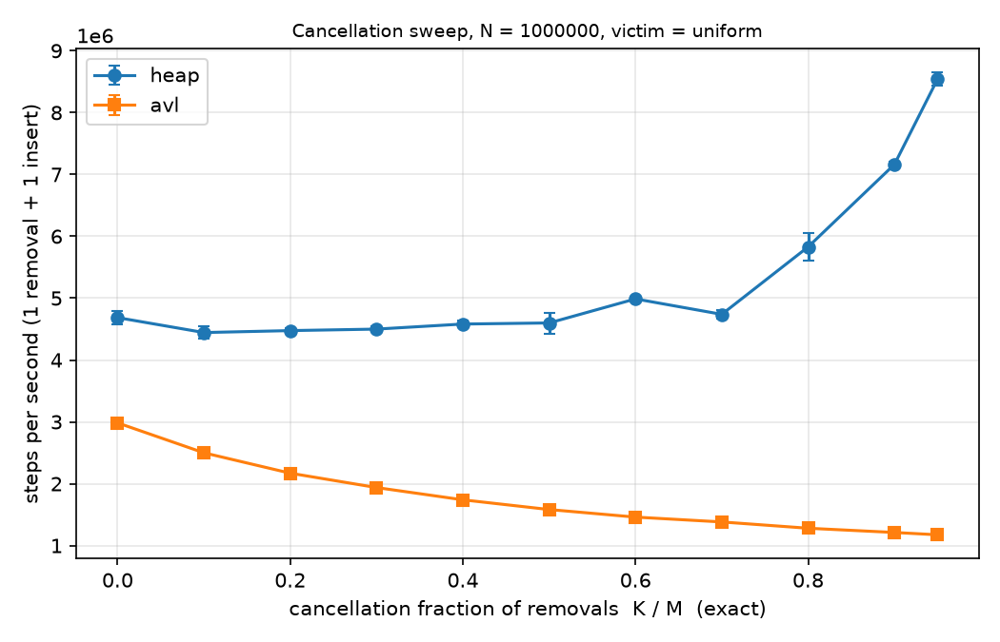
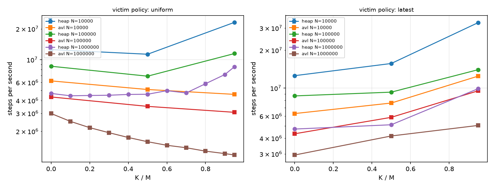

# REPORT — Project 9: Event scheduler, heap against balanced tree

Team O(n²) · CS 253 / MA 253 · Aditya Singh (Architect), Gulam Abbas (Structure A), Aryan Arya
(Structure B), Hiransh Anand (Oracle), Sanchit Goyal (Adversary), Ram Upadhyay (Analyst)

> **Where the numbers come from.** Sections marked **[MEASURE]** are written by
> `scripts/fill_report.py` only from files that `make bench` produced on the one machine named in §6.1
> (`results/summary.csv`, `results/raw/`, `results/profiler/`). Sections marked **[DETERMINISTIC]** are
> reproduced exactly by `make test` on any machine. No number is copied from anywhere else. AI use is
> declared in TOOLS.md.

## 1. Problem and interface (Architect)

A discrete-event network simulator keeps a future event set in which most timers are cancelled before
they fire, and it also needs "the next event after time t". Every structure implements
`include/event_queue.h` (contract and invariants in INTERFACE.md):

| Operation | Meaning |
|---|---|
| `insert(t, type, data) → handle` | key = (t, seq); seq assigned by the base class, so keys are unique |
| `cancel(handle) → bool` | true exactly once while the event is pending |
| `pop_min`, `peek_min` | the pending event with the smallest key |
| `successor(t)` | the pending event with the smallest key among those with time > t (strict) |

Design decisions: integer microsecond time (real ties, no floating-point drift); key = (time, seq) so
ties leave FIFO and the order is total (D3); handle = key (the AVL tree cancels by key, the heap checks
seq *and* time); one shared, exact cancel semantics so the differential test can compare everything;
our own integer mapping on `std::mt19937_64` instead of `std::*_distribution` (portable output).

## 2. Structure A — lazy binary heap (Structure A owner)

The heap is an array of entries (time, seq, type, data) ordered by the key (time, seq); the children of
index i are 2i+1 and 2i+2. Sift-up and sift-down use the hole method: the moving entry is held aside,
entries slide into the hole, and it is written once at the end, so a sift of depth d costs d+1 moves
instead of 3d.

```
 heap array (ordered by key)            SeqTable (open addressing, keyed by seq)
 [0] (5,#3)                              slot = (seq * 0x9E3779B97F4A7C15) >> (64 - log2 capacity)
 [1] (7,#1)   [2] (9,#4)                 record: seq -> (time, cancelled flag)
 [3] (8,#2)x  ...                        x = cancelled: still in the array, flagged in the table
```

**Cancellation is lazy.** A binary heap cannot find an entry by handle, so every entry in the array has
a record in `SeqTable`: open addressing with linear probing, Fibonacci hashing of the sequence number,
tombstones on erase, and a rebuild when occupied + tombstones exceed half the capacity. `cancel(h)`
looks the handle up, checks both seq and time, and sets a flag — O(1) expected, no sifting. The entry
stays in the array until it reaches the root, where `pop_min`/`peek_min` discard it, or until a purge.

**Purge.** With L live and C cancelled entries, the heap purges whenever C > L, after every successful
cancel *and* after every pop (a pop lowers L, so it can also break C ≤ L). A purge keeps the live
entries, erases the cancelled records and rebuilds the heap with Floyd's method. Hence the array never
holds more than 2L entries after an operation, and the cost is O(log n) amortised (D1).

**Successor(t)** is a depth-first search that prunes every subtree whose root time is already no better
than the best candidate; it is O(m) in the worst case, which is the heap's honest weakness for this
operation and the AVL tree's strength.

**Decision we defend.** The table records every heap entry, not only cancelled ones, so `cancel` has
exactly the same meaning on both structures (false for an unknown, popped or already cancelled handle)
and the differential test can compare every return value. To keep that cheap, `pop_min` reuses the
slot it found when checking the root to erase the record, so a hold without cancellations costs two
table operations (one lookup-and-erase, one insert), not three.

## 3. Structure B — AVL tree (Structure B owner)

Nodes live in one contiguous pool (a growable array) and refer to each other by 32-bit indices, not
pointers; freed nodes go on a free list and are reused. Index 0 is NIL, a sentinel whose height is −1,
so `height(child)` needs no null test and a leaf has height 0.

`insert` and `cancel` (delete by key) are recursive: they walk down by comparing (time, seq), and on
the way back up every node recomputes its height and is rebalanced if its children's heights differ by
2. `pop_min` deletes along the left spine. `successor(t)` is one root-to-leaf walk that remembers the
last node with time > t: O(log n).

```
   left-heavy at z, left child y not right-heavy: one right rotation

          z                    y
         / \                  / \
        y   D      ==>       x   z
       / \                      / \
      x   C                    C   D
```

If y leans the other way (the "zig-zag" case) y is first rotated left, then z right: a double rotation.
The rule uses strict comparison of the grandchildren's heights, so the equal-height case that arises
only in deletion takes the single rotation. An insertion needs at most one rebalance (D5); a deletion
can need one at every level (the Fibonacci-tree attack in §7 makes it do so). The height is below
1.45·log₂(n+2) (D2).

**Decision we defend.** Because the pool can grow and move during an insertion, the code never keeps a
reference or pointer to a node across a call that may allocate: it holds indices and re-reads the node
afterwards. This is the bug class that indices-in-a-pool invites, and the sanitizer runs cover it.

## 4. Correctness evidence (Oracle owner) **[DETERMINISTIC]**

| Evidence | Result (`make test`) |
|---|---|
| Hand-computed edge-case suites (5 files), checker after every operation | identical on heap, AVL, oracle |
| Generated attack suites (11 files) vs oracle output | identical on heap and AVL |
| Differential test, seeds 1, 2, 3, 10⁶ operations each, live size ≤ 10⁴ | no disagreement; checkers passed |
| Mutation tests: LIFO ties, cancel ignoring time, non-strict successor, no post-pop purge, stale AVL height, duplicate heap entry + orphan record, bad AVL edges (out of range, cycle, shared child, leaked slot), table record moved past an EMPTY slot (unreachable by probing, so `cancel` would fail) | all 8 caught |
| Shrinker on a planted bug | literal `.ops` reproducer; the test re-checks that removing any single operation makes the bug disappear (1-minimal) |
| Command-line hardening (`tests/cli_test.sh`) | out-of-range or malformed arguments exit 2 at once (no hang, no `inf`/`nan` rows); a CSV or stdout write failure (e.g. a full disk) exits 4 instead of reporting success; `plot.py` rejects empty CSVs |
| CSV validation (`tests/plot_test.py`, synthetic fixture) | 15 defects each rejected before any output is written: mismatched warm-up / holds / steps, checksum disagreement, duplicate row, missing queue mate, incomplete matrix, row outside the matrix, inconsistent cancels, out-of-range values, `nan`, wrong build, empty file; exact ties classified as ties |
| Profiler logic (`tests/profile_test.sh`, fake `perf`) | USABLE / UNAVAILABLE / FAILED reported correctly (zero or implausible counts, a failed run, a failed self-check all give FAILED and exit 1); the benchmark exits 3 if perf does not acknowledge enable/disable |
| Full scale: 10⁶ resident events in each structure, drained in order; heap vs AVL on 10⁶ mixed operations at 10⁶ live | passed |
| Sanitizers (ASan + UBSan, leak detection on) over the whole suite | clean |
| Toolchains: g++ 13 / libstdc++, clang 18 / libstdc++, clang 18 / libc++ | all tests pass; identical simulator output |

Unit tests only check the cases someone thought of. The differential test instead runs the same
generated history on the heap, the AVL tree and the oracle in lockstep and compares every return value
and every returned event, so any disagreement on any operation among a million is caught, and the
shrinker cuts the history down to a few lines. The oracle is a sorted array, simple enough to be
checked by reading. Agreement of outputs is still not enough — a structure can answer correctly while
its internals are already corrupt — so the checkers recompute each structure's invariants from the
raw arrays without trusting any stored field: heap order, table/array agreement and probe-path
reachability for A; ordering, recomputed heights, balance and reachability for B (D4 proves the AVL
checker accepts exactly the valid trees). The mutation tests show that each of these checks can fail.

## 5. Application (Architect) **[DETERMINISTIC]**

Stop-and-wait flows with a retransmission timer and an ACK-inactivity watchdog; exactly 10⁶ dispatched
events; integer arithmetic only. Default run (`sim`, seed 1), identical on heap and AVL:

```
inserted=2962238 processed=1000000 cancelled=1907484 pending=54754
rto_cancelled=953742 idle_cancelled=953742
transmissions=1019981 retransmissions=46239 delivered=953742 idle_fired=0 monitors=19
ties=222069 peak_live=59028 end_time_us=1929077
checksum=0xcbd12e722cac3922
monitor_successors=0xebce99f1c00b6707
```

64.4 % of scheduled events are cancelled (model estimate 2q/(1+2q) = 65.5 % at q = 0.95, minus
start-up/end effects); 222 069 consecutive equal timestamps exercise the tie rule; conservation
`inserted = processed + cancelled + pending` is checked after every event.

## 6. Measurements (Analyst)

<!-- MEASURED-A:BEGIN (generated by scripts/fill_report.py — do not edit by hand) -->
### 6.1 Machine **[MEASURE]**

```
date: Thu Nov 19 19:02:58 IST 2026
uname: Darwin Adityas-Mac-2.local 27.2.0 Darwin Kernel Version 27.2.0: Wed Oct 14 23:47:07 PDT 2026; root:xnu-13432.41.4~25/RELEASE_ARM64_T8132 arm64
Apple M4
hw.ncpu: 10
hw.l1dcachesize: 65536
hw.l2cachesize: 4194304
hw.memsize: 17179869184
compiler: Apple clang version 21.0.0 (clang-2100.4.1.1)
flags: -std=c++17 -O2 -DNDEBUG (release); counting build adds -DEQ_COUNTING=1
mode: --full
power: Now drawing from 'AC Power'
load average at start: 3.19 2.50 2.40
run conditions: one run, benchmarks strictly one after another; close other programs and stay plugged in
```

All timings below come from this one machine and this one run of `make bench`.
<!-- MEASURED-A:END -->

### 6.2 Method
Hold model as in Jones (1986): Jones's random-walk initialisation (P(enqueue) = 0.55), warm-up
max(10⁶, 5N) holds, then max(10⁶, N) timed holds with pre-generated increments; one hold = pop_min +
insert. Distributions: Jones Table I as printed, divided by their ideal means (the printed bimodal has
mean 1.42857, not 1 as Jones's footnote says), scaled to mean 1000 µs. Cancellation sweep: one step =
one successful removal + one insertion, exactly K = round(c·M) cancellations, victim uniform or
largest-key, stream generated before timing and replayed identically on A and B. Five seeds per point,
A and B on the same seed, order alternated (AB/BA).

The metric is **throughput** (the handout's): holds per second and steps per second, from the
`holds_per_sec` / `steps_per_sec` columns (CSV version 3), shown as mean ± sample s.d. over runs. A and B
are compared by **paired** throughput ratios heap/AVL on the same workload — same distribution, N,
warm-up, timed length, seed, repeat and mean (`results/paired_ratios.csv` lists every one). Throughput
is recomputed from the exact integers (operations × 10⁹ / elapsed_ns). `results/plot.py` writes nothing
unless every CSV is valid: right version, columns and build; values in range and mutually consistent;
no duplicate run; exactly the prescribed matrix (five seeds, prescribed warm-up and lengths, nothing
missing or extra); the same popped-key checksum for every queue on the same workload.

Operation counts come only from the counting build (`BUILD=count`, never timed); in timing builds all
`counters()` fields stay 0. A few structure statistics stay on in timing builds (heap purges, purged
and stale entries, peak size, table rebuilds; AVL rebalances): each is one integer increment on an
event that already does far more work (a purge, a rotation, a rebuild, a discarded root, an insert's
size check), so their cost is expected to be negligible; it was not measured separately.


<!-- MEASURED-B:BEGIN (generated by scripts/fill_report.py — do not edit by hand) -->
### 6.3 Predicted (docs/MODEL_D6.md, committed before the final runs) vs measured **[MEASURE]**

Operation counts per hold, counting build (one seed per point):

| queue | distribution | N | comparisons | moves | hash probes | rehash probes | rebalances | P1 predicted | P1 |
|---|---|---|---|---|---|---|---|---|---|
| avl | bimodal | 1000 | 10.26 | 0.00 | 0.00 | 0.000 | 1.057 | rebalances 0.9…1.2 | in range |
| heap | bimodal | 1000 | 18.27 | 8.20 | 2.33 | 0.995 | 0.000 | cmp ≈ 2·log₂N ± 3 = 16.9…22.9; probes 1.7…2.3 | **outside** |
| avl | bimodal | 10000 | 13.85 | 0.00 | 0.00 | 0.000 | 1.229 | rebalances 0.9…1.2 | **outside** |
| heap | bimodal | 10000 | 24.65 | 11.20 | 2.08 | 0.419 | 0.000 | cmp ≈ 2·log₂N ± 3 = 23.6…29.6; probes 1.7…2.3 | in range |
| avl | bimodal | 100000 | 17.50 | 0.00 | 0.00 | 0.000 | 1.451 | rebalances 0.9…1.2 | **outside** |
| heap | bimodal | 100000 | 30.98 | 14.27 | 2.19 | 0.631 | 0.000 | cmp ≈ 2·log₂N ± 3 = 30.2…36.2; probes 1.7…2.3 | in range |
| avl | bimodal | 1000000 | 20.65 | 0.00 | 0.00 | 0.000 | 1.502 | rebalances 0.9…1.2 | **outside** |
| heap | bimodal | 1000000 | 37.11 | 17.29 | 2.31 | 1.086 | 0.000 | cmp ≈ 2·log₂N ± 3 = 36.9…42.9; probes 1.7…2.3 | **outside** |
| avl | exponential | 1000 | 10.24 | 0.00 | 0.00 | 0.000 | 1.041 | rebalances 0.9…1.2 | in range |
| heap | exponential | 1000 | 18.75 | 8.67 | 2.07 | 0.940 | 0.000 | cmp ≈ 2·log₂N ± 3 = 16.9…22.9; probes 1.7…2.3 | in range |
| avl | exponential | 10000 | 13.82 | 0.00 | 0.00 | 0.000 | 1.226 | rebalances 0.9…1.2 | **outside** |
| heap | exponential | 10000 | 25.21 | 11.75 | 2.01 | 0.431 | 0.000 | cmp ≈ 2·log₂N ± 3 = 23.6…29.6; probes 1.7…2.3 | in range |
| avl | exponential | 100000 | 17.38 | 0.00 | 0.00 | 0.000 | 1.451 | rebalances 0.9…1.2 | **outside** |
| heap | exponential | 100000 | 31.59 | 14.85 | 2.03 | 0.605 | 0.000 | cmp ≈ 2·log₂N ± 3 = 30.2…36.2; probes 1.7…2.3 | in range |
| avl | exponential | 1000000 | 20.71 | 0.00 | 0.00 | 0.000 | 1.501 | rebalances 0.9…1.2 | **outside** |
| heap | exponential | 1000000 | 37.99 | 18.02 | 2.06 | 1.017 | 0.000 | cmp ≈ 2·log₂N ± 3 = 36.9…42.9; probes 1.7…2.3 | in range |
| avl | triangular | 1000 | 10.52 | 0.00 | 0.00 | 0.000 | 1.064 | rebalances 0.9…1.2 | in range |
| heap | triangular | 1000 | 18.96 | 8.89 | 2.00 | 0.954 | 0.000 | cmp ≈ 2·log₂N ± 3 = 16.9…22.9; probes 1.7…2.3 | in range |
| avl | triangular | 10000 | 14.08 | 0.00 | 0.00 | 0.000 | 1.233 | rebalances 0.9…1.2 | **outside** |
| heap | triangular | 10000 | 25.68 | 12.21 | 2.00 | 0.440 | 0.000 | cmp ≈ 2·log₂N ± 3 = 23.6…29.6; probes 1.7…2.3 | in range |
| avl | triangular | 100000 | 17.43 | 0.00 | 0.00 | 0.000 | 1.454 | rebalances 0.9…1.2 | **outside** |
| heap | triangular | 100000 | 32.30 | 15.50 | 2.00 | 0.600 | 0.000 | cmp ≈ 2·log₂N ± 3 = 30.2…36.2; probes 1.7…2.3 | in range |
| avl | triangular | 1000000 | 20.69 | 0.00 | 0.00 | 0.000 | 1.509 | rebalances 0.9…1.2 | **outside** |
| heap | triangular | 1000000 | 38.81 | 18.75 | 2.00 | 1.000 | 0.000 | cmp ≈ 2·log₂N ± 3 = 36.9…42.9; probes 1.7…2.3 | in range |
| avl | uniform | 1000 | 10.38 | 0.00 | 0.00 | 0.000 | 1.053 | rebalances 0.9…1.2 | in range |
| heap | uniform | 1000 | 18.92 | 8.86 | 2.00 | 0.938 | 0.000 | cmp ≈ 2·log₂N ± 3 = 16.9…22.9; probes 1.7…2.3 | in range |
| avl | uniform | 10000 | 13.95 | 0.00 | 0.00 | 0.000 | 1.230 | rebalances 0.9…1.2 | **outside** |
| heap | uniform | 10000 | 25.51 | 12.05 | 2.00 | 0.440 | 0.000 | cmp ≈ 2·log₂N ± 3 = 23.6…29.6; probes 1.7…2.3 | in range |
| avl | uniform | 100000 | 17.38 | 0.00 | 0.00 | 0.000 | 1.453 | rebalances 0.9…1.2 | **outside** |
| heap | uniform | 100000 | 31.99 | 15.22 | 2.00 | 0.700 | 0.000 | cmp ≈ 2·log₂N ± 3 = 30.2…36.2; probes 1.7…2.3 | in range |
| avl | uniform | 1000000 | 20.68 | 0.00 | 0.00 | 0.000 | 1.508 | rebalances 0.9…1.2 | **outside** |
| heap | uniform | 1000000 | 38.43 | 18.42 | 2.00 | 1.000 | 0.000 | cmp ≈ 2·log₂N ± 3 = 36.9…42.9; probes 1.7…2.3 | in range |

Predictions P1–P7 against the measurements (decided mechanically from the tables in this section; a refuted prediction stays here with its numbers):

| prediction | result | measured |
|---|---|---|
| P1 | REFUTED | 18 of 32 points inside the predicted ranges; outside: heap bimodal N=1000, avl bimodal N=10000, avl bimodal N=100000, avl bimodal N=1000000, heap bimodal N=1000000, avl exponential N=10000, avl exponential N=100000, avl exponential N=1000000, avl triangular N=10000, avl triangular N=100000, avl triangular N=1000000, avl uniform N=10000, avl uniform N=100000, avl uniform N=1000000 |
| P2 | CONFIRMED | heap faster on every seed at 16 of 16 (distribution, N) points |
| P3 | REFUTED | AVL/heap time ratio at N=1000: 1.67–1.89 (predicted 1.3–2); at N=1000000: 1.48–1.98 (predicted 1.5–3); grows from smallest to largest N for 1 of 4 distributions |
| P4 | REFUTED | largest spread across distributions at a fixed N: heap 13.8 %, AVL 32.5 % (predicted: heap almost none, AVL < 20 %) |
| P5 | REFUTED | sorted array fastest at N = [10, 30]; slower than both heap and AVL at N = none (predicted: fastest up to about 30, loses to both from 100–300) |
| P6 | REFUTED | from the lowest to the highest cancellation rate the heap's throughput rises in 6 of 6 (policy, N) series and the heap/AVL ratio grows in 5; crossovers: 0 |
| P7 | CONFIRMED | largest peak physical/live = 2.0000 (bound 2, D1; at most 2 + 1/N inside an operation); 2.000 at the highest rate |

### 6.4 Hold model **[MEASURE]**


Throughput in holds per second, mean ± s.d. over the seeds; ratio = heap/AVL throughput on the same seed (= AVL/heap time).

| distribution | N | heap | AVL | mean ratio | min–max | heap faster in | every seed |
|---|---|---|---|---|---|---|---|
| exponential | 1000 | 16.28 M ± 186 k | 9.01 M ± 23 k | 1.8071 | 1.7651–1.8201 | 5/5 | heap |
| exponential | 10000 | 11.68 M ± 941 k | 5.97 M ± 113 k | 1.9559 | 1.8044–2.1239 | 5/5 | heap |
| exponential | 100000 | 7.82 M ± 510 k | 4.12 M ± 177 k | 1.9031 | 1.7132–2.0763 | 5/5 | heap |
| exponential | 1000000 | 4.76 M ± 303 k | 2.46 M ± 360 k | 1.9788 | 1.7046–2.6423 | 5/5 | heap |
| uniform | 1000 | 16.75 M ± 261 k | 9.24 M ± 140 k | 1.8132 | 1.7990–1.8286 | 5/5 | heap |
| uniform | 10000 | 12.29 M ± 462 k | 5.78 M ± 410 k | 2.1349 | 2.0556–2.3984 | 5/5 | heap |
| uniform | 100000 | 8.27 M ± 1.04 M | 4.37 M ± 293 k | 1.8863 | 1.6679–1.9958 | 5/5 | heap |
| uniform | 1000000 | 4.67 M ± 283 k | 2.94 M ± 270 k | 1.5969 | 1.4524–1.7600 | 5/5 | heap |
| bimodal | 1000 | 15.58 M ± 138 k | 9.34 M ± 104 k | 1.6684 | 1.6587–1.6831 | 5/5 | heap |
| bimodal | 10000 | 11.56 M ± 833 k | 6.09 M ± 495 k | 1.9059 | 1.6253–2.1544 | 5/5 | heap |
| bimodal | 100000 | 8.31 M ± 156 k | 4.72 M ± 47 k | 1.7622 | 1.7350–1.8086 | 5/5 | heap |
| bimodal | 1000000 | 4.81 M ± 29 k | 3.26 M ± 99 k | 1.4780 | 1.4227–1.5371 | 5/5 | heap |
| triangular | 1000 | 17.73 M ± 75 k | 9.40 M ± 138 k | 1.8866 | 1.8614–1.9192 | 5/5 | heap |
| triangular | 10000 | 12.11 M ± 777 k | 6.14 M ± 320 k | 1.9707 | 1.8958–2.0446 | 5/5 | heap |
| triangular | 100000 | 8.66 M ± 276 k | 4.70 M ± 65 k | 1.8418 | 1.7837–1.9248 | 5/5 | heap |
| triangular | 1000000 | 4.87 M ± 68 k | 3.16 M ± 42 k | 1.5392 | 1.5218–1.5621 | 5/5 | heap |

Overhead control (the same loop with no queue, exponential): N=1000: 1742.09 M holds/s, N=10000: 1893.88 M holds/s, N=100000: 1827.77 M holds/s, N=1000000: 1885.07 M holds/s. It is context only; nothing is subtracted.

### 6.5 Small queues **[MEASURE]**


| N | sorted array | heap | AVL | fastest (mean) |
|---|---|---|---|---|
| 10 | 49.07 M | 36.18 M | 30.12 M | sorted array |
| 30 | 33.22 M | 27.32 M | 17.76 M | sorted array |
| 100 | 22.41 M | 23.78 M | 12.93 M | heap |
| 300 | 13.58 M | 21.54 M | 10.60 M | heap |

### 6.6 Cancellation sweep **[MEASURE]**






Throughput in steps per second (one removal + one insertion); ratio = heap/AVL on the same seed. A point favours one structure only if every seed's ratio is strictly on that side; this is a consistency criterion over the paired runs, not a formal significance test.

| policy | N | K/M | heap | AVL | mean ratio | min–max | every seed |
|---|---|---|---|---|---|---|---|
| latest | 10000 | 0.0000 | 12.56 M | 6.28 M | 2.0007 | 1.9781–2.0389 | heap |
| latest | 10000 | 0.5000 | 15.69 M | 7.61 M | 2.0621 | 2.0345–2.1090 | heap |
| latest | 10000 | 0.9500 | 33.13 M | 12.45 M | 2.6605 | 2.6384–2.6895 | heap |
| latest | 100000 | 0.0000 | 8.67 M | 4.34 M | 1.9998 | 1.9578–2.0433 | heap |
| latest | 100000 | 0.5000 | 9.29 M | 5.86 M | 1.5855 | 1.5697–1.6029 | heap |
| latest | 100000 | 0.9500 | 14.01 M | 9.51 M | 1.4721 | 1.4487–1.4961 | heap |
| latest | 1000000 | 0.0000 | 4.73 M | 2.94 M | 1.6080 | 1.5913–1.6206 | heap |
| latest | 1000000 | 0.5000 | 5.11 M | 4.16 M | 1.2280 | 1.2130–1.2420 | heap |
| latest | 1000000 | 0.9500 | 9.89 M | 5.05 M | 1.9583 | 1.9437–1.9691 | heap |
| uniform | 10000 | 0.0000 | 12.55 M | 6.21 M | 2.0215 | 1.9992–2.0481 | heap |
| uniform | 10000 | 0.5000 | 11.31 M | 5.12 M | 2.2110 | 2.1683–2.2410 | heap |
| uniform | 10000 | 0.9500 | 23.17 M | 4.59 M | 5.0514 | 4.9113–5.2463 | heap |
| uniform | 100000 | 0.0000 | 8.63 M | 4.33 M | 1.9954 | 1.9063–2.0549 | heap |
| uniform | 100000 | 0.5000 | 6.91 M | 3.50 M | 1.9722 | 1.9413–2.0177 | heap |
| uniform | 100000 | 0.9500 | 11.49 M | 3.06 M | 3.7481 | 3.6581–3.8224 | heap |
| uniform | 1000000 | 0.0000 | 4.69 M | 2.98 M | 1.5706 | 1.5300–1.6210 | heap |
| uniform | 1000000 | 0.1000 | 4.44 M | 2.50 M | 1.7782 | 1.6934–1.8223 | heap |
| uniform | 1000000 | 0.2000 | 4.48 M | 2.17 M | 2.0623 | 2.0205–2.0777 | heap |
| uniform | 1000000 | 0.3000 | 4.50 M | 1.94 M | 2.3222 | 2.2975–2.3655 | heap |
| uniform | 1000000 | 0.4000 | 4.58 M | 1.74 M | 2.6338 | 2.5964–2.6555 | heap |
| uniform | 1000000 | 0.5000 | 4.60 M | 1.58 M | 2.9085 | 2.7252–3.1235 | heap |
| uniform | 1000000 | 0.6000 | 4.99 M | 1.46 M | 3.4163 | 3.3758–3.4579 | heap |
| uniform | 1000000 | 0.7000 | 4.74 M | 1.38 M | 3.4308 | 3.2574–3.5287 | heap |
| uniform | 1000000 | 0.8000 | 5.83 M | 1.28 M | 4.5532 | 4.2524–4.6932 | heap |
| uniform | 1000000 | 0.9000 | 7.16 M | 1.21 M | 5.9118 | 5.8005–6.1236 | heap |
| uniform | 1000000 | 0.9500 | 8.54 M | 1.17 M | 7.2760 | 7.1149–7.3580 | heap |

**Crossover:** none — no change of side between neighbouring cancellation rates under either policy.

Heap peak physical entries / live entries (maximum over all seeds, policies and N): c=0 %: 1.000, c=10 %: 1.093, c=20 %: 1.200, c=30 %: 1.323, c=40 %: 1.466, c=50 %: 2.000, c=60 %: 1.827, c=70 %: 2.000, c=80 %: 2.000, c=90 %: 2.000, c=95 %: 2.000.

### 6.7 Quantisation sensitivity **[MEASURE]**

The same hold runs with mean increment 10⁶ µs instead of 10³ µs (so almost no increment rounds to zero):

| distribution | N | ratio, mean 10³ µs | every seed | zero increments | ratio, mean 10⁶ µs | every seed | zero increments |
|---|---|---|---|---|---|---|---|
| bimodal | 100000 | 1.7622 | heap | 0.000685 | 2.0536 | heap | 0.000000 |
| exponential | 100000 | 1.9031 | heap | 0.000497 | 2.2397 | heap | 0.000000 |

Rounding increments to whole microseconds does not change which structure is faster at these points.

### 6.8 Cache behaviour **[MEASURE]**

No usable profiler output (profiler status: UNAVAILABLE); we make no cache claims.
<!-- MEASURED-B:END -->

## 7. Adversarial inputs (Adversary) **[DETERMINISTIC]**

| Attack | Target | What it did (`make test`) |
|---|---|---|
| ascending 1..N | AVL rotations | 990 rebalances for N = 1000; 999 980 for N = 10⁶ (rotation-free exactly at powers of two) |
| zigzag 1, N, 2, N−1, … | AVL double rotations | 617 double + 371 single rebalances for N = 1000 |
| Fibonacci tree + delete-min | deletion cascades | built with 0 rotations; then ONE delete-min performs ⌊h/2⌋ rotations (h = 10, 11, 20, 21, 27 → 5, 5, 10, 10, 13; h = 27 has 832 039 nodes) |
| bloat (L = 100, 3000 steps) | lazy-heap growth | 3 100 physical entries without purging vs 200 with purging |
| drain (N = 1000) | post-pop purge check | 500 entries for 1 live event without it vs 1 with it |
| storm, regrow, latesucc, random | ties, capacity reuse, O(m) heap successor | identical results on all three queues |

**Ascending and zigzag (AVL).** Inserting increasing keys always extends the rightmost path, so the
tree becomes right-heavy again and again; by D5 every insertion that does not raise the height of the
whole tree must rotate, so all but about 1.45·log₂ n insertions rotate. Zigzag (1, N, 2, N−1, …) places
each new key on the inside of a subtree, which is the double-rotation case.

**Fibonacci tree + delete-min (AVL).** A Fibonacci tree is the sparsest AVL tree: every internal node
already leans one way (D2's extremal case). Built with every node leaning right, removing the minimum
shortens the short side at the bottom, the rotation there shortens that subtree, and the imbalance
moves up: ⌊h/2⌋ rotations from one deletion, the O(log n) worst case that insertion never has.

**Bloat and drain (lazy heap).** Bloat cancels events with late timestamps and replaces them, so
cancelled entries never reach the root and, without purging, the array grows without bound while the
live size stays L; with the purge rule it stays within 2L (D1). Drain cancels half the events and then
pops the rest: only pops lower L, so a rule that purged after cancels alone would leave C > L — which
is why the heap also checks after every pop.

**Storm, regrow, latesucc, random.** Storm inserts many events at one timestamp (FIFO order among ties
must hold, D3). Regrow fills, empties and refills (capacity and free-list reuse). Latesucc asks for
successors near the largest time, where the heap's pruned search degenerates to O(m). Random mixes
everything from a seed. All give identical results on the three queues.

## 8. Derivations

D1–D6 are separate PDFs in `docs/derivations/` (`D1.pdf` … `D6.pdf`), each naming its author on page 1;
the `.md` files beside them are their sources (`make pdfs` rebuilds them).

| | Author | Statement |
|---|---|---|
| D1 | Gulam Abbas | lazy heap: at most 2L entries; O(log n) amortised with purge after cancel and pop |
| D2 | Aryan Arya | an AVL tree of height h has at least F(h+3) − 1 nodes, so h < 1.45·log₂(n+2) |
| D3 | Aditya Singh | (time, seq) ordering makes the run deterministic; dispatched timestamps never decrease |
| D4 | Hiransh Anand | the AVL checker accepts exactly the valid AVL trees |
| D5 | Sanchit Goyal | at most one rebalance per insertion; ascending input rotates on all but O(log n) insertions |
| D6 | Ram Upadhyay | the cost model and its predictions P1–P7 |

## 9. Limitations and honest notes

- The default simulator keeps about 6·10⁴ events live; the 10⁶-resident requirement is met by the full-scale
  test and the benchmarks, not by the simulator's default run.
- The heap's `successor` is O(m) by design; the simulator calls it only once per simulated 100 ms.
- Expected O(1) hash costs assume the keys spread well; Fibonacci hashing of sequential seqs does, but
  it is not an adversarial guarantee.
- The cost model (D6) was written after exploratory prototype runs and after Claude's one discarded
  run of the full benchmark matrix on a shared VM while verifying the draft (see TOOLS.md and
  MODEL_D6.md §0); it was revised on 9 Nov for three mechanism statements, with predictions unchanged.
